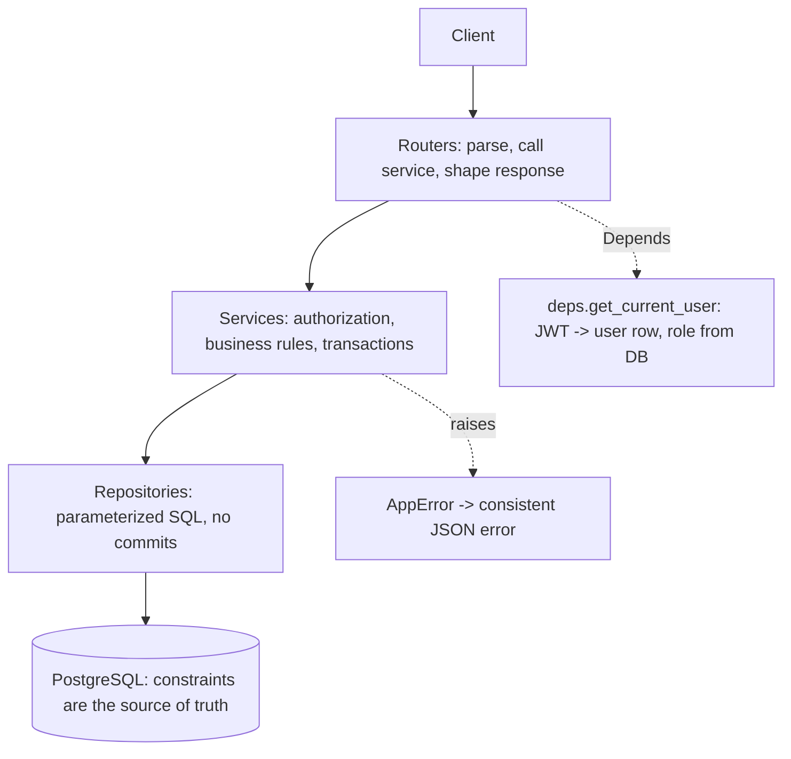
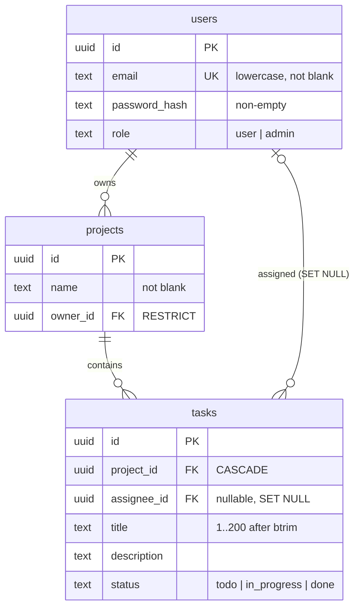
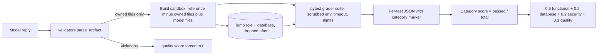

# Architecture

Two systems live in this repository: the **Task Management API** (the thing being
engineered) and the **RLVR environment** (the thing that trains and scores a model
engineering it).

## 1. The API under test



Database schema (invariants enforced by PostgreSQL):



Authorization policy (read from the database, never from token claims):

| Actor | create task | list tasks | patch status | patch other fields | delete project |
| --- | --- | --- | --- | --- | --- |
| owner / admin | yes | all | yes | yes | yes (409 if any task in_progress) |
| assignee | 403 | own tasks only | own task | 403 | 403 |
| stranger | 403 | 403 | 403 | 403 | 403 |
| unauthenticated | 401 | 401 | 401 | 401 | 401 |

Unknown ids are 404; a malformed UUID is 422.

### The delete rule is race-free

The rule "a project with an in_progress task cannot be deleted" needs the check and the delete in one transaction **and** every writer that can move a task into `in_progress` must conflict with the deleter:

```mermaid
sequenceDiagram
    participant Del as DELETE /projects/id
    participant DB as PostgreSQL
    participant Pat as PATCH /tasks/id (status=in_progress)
    Del->>DB: BEGIN; SELECT ... FROM projects FOR UPDATE
    Pat->>DB: BEGIN; SELECT ... FROM projects FOR SHARE
    Note over Pat,DB: blocks: FOR SHARE conflicts with FOR UPDATE
    Del->>DB: EXISTS in_progress task? no
    Del->>DB: DELETE project (tasks cascade); COMMIT
    DB-->>Pat: lock granted, project row gone
    Pat-->>Pat: 404, never a silently destroyed in_progress task
```

If the patch wins the lock first, the delete sees the in_progress task and returns 409.

## 2. The RLVR environment

Each task asks the model to write a fixed set of files. Everything else comes from the gold reference, so a rollout is scored only on what the model wrote.

| Task | Model writes | Graded by |
| --- | --- | --- |
| 1 schema | `migrations/0001_init.sql` | `tests/test_task_01_schema.py` |
| 2 auth | `app/security.py`, `app/services/auth_service.py`, `app/routers/auth.py` | `tests/test_task_02_auth.py` |
| 3 crud | `app/repositories/{projects,tasks}.py`, `app/routers/{projects,tasks}.py` | `tests/test_task_03_crud.py` |
| 4 authorization | `app/services/project_service.py` | `tests/test_task_04_authorization.py` |
| 5 validation | `app/schemas.py`, `app/errors.py`, `app/repositories/users.py` | `tests/test_task_05_security.py` |
| 6 e2e | `app/main.py`, `tests/test_e2e.py`, `Dockerfile`, `docker-compose.yml`, `.env.example`, `README.md` | `tests/test_task_06_e2e.py` |



Design points:

- **Artifact, not keywords.** The reply must contain an `<implementation>` block of complete files; the reward executes them. No LLM judge, no keyword matching.
- **Hidden tests.** Tests marked `hidden` (adversarial and edge cases such as alg-confusion JWTs, NUL bytes, concurrent registrations, the delete race) are never described in the prompt.
- **Deterministic race test.** Task 4 hooks the project `DELETE` statement and fires the competing write at that exact point, so a lock-free implementation fails every run instead of occasionally.
- **Parameterized tasks.** Password minimum, title maximum and token TTL vary per row; the same values reach the prompt, the reference app and the graders, so rows are different verifiable tasks rather than paraphrases.
- **Skips and errors are failures.** A category with no passing tests scores 0.
- **Infrastructure errors raise.** A missing database never silently becomes a zero reward.
- **Graders discriminate.** `tests/test_graders_discriminate.py` runs deliberately broken implementations (no CHECK, plaintext passwords, string-built SQL, missing locks, no authorization, leaky 500s, root container) and requires each to score below the gold solution.
